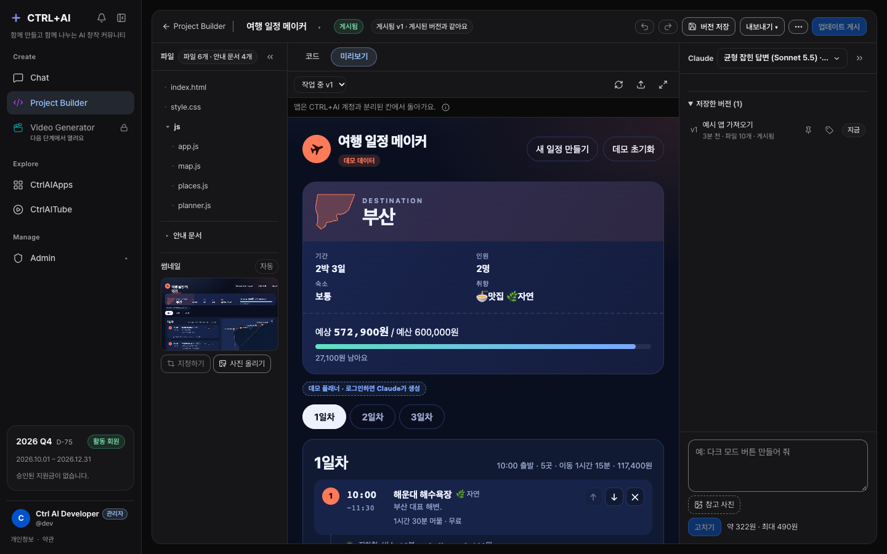
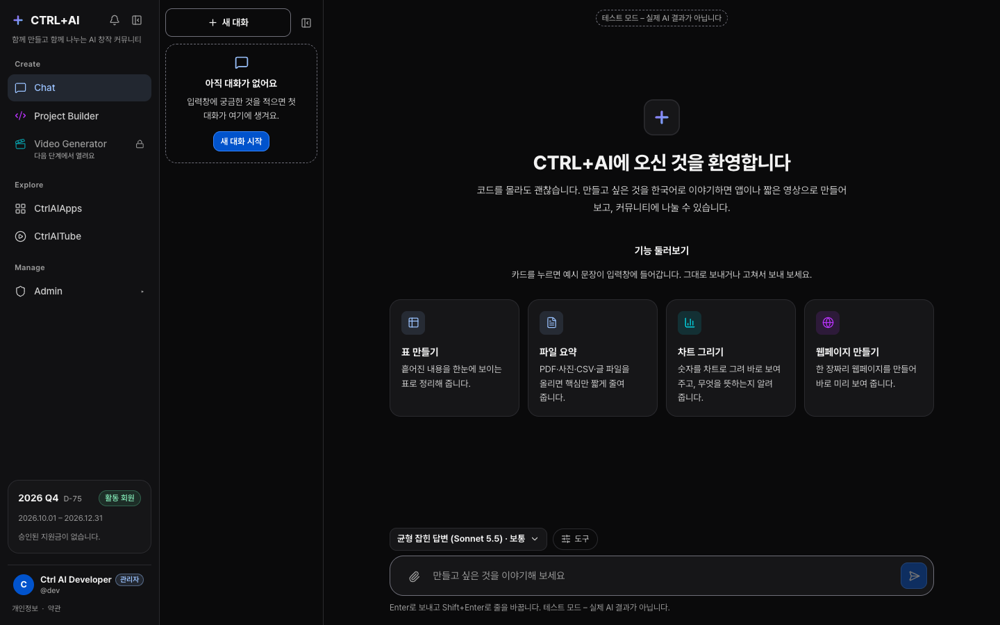
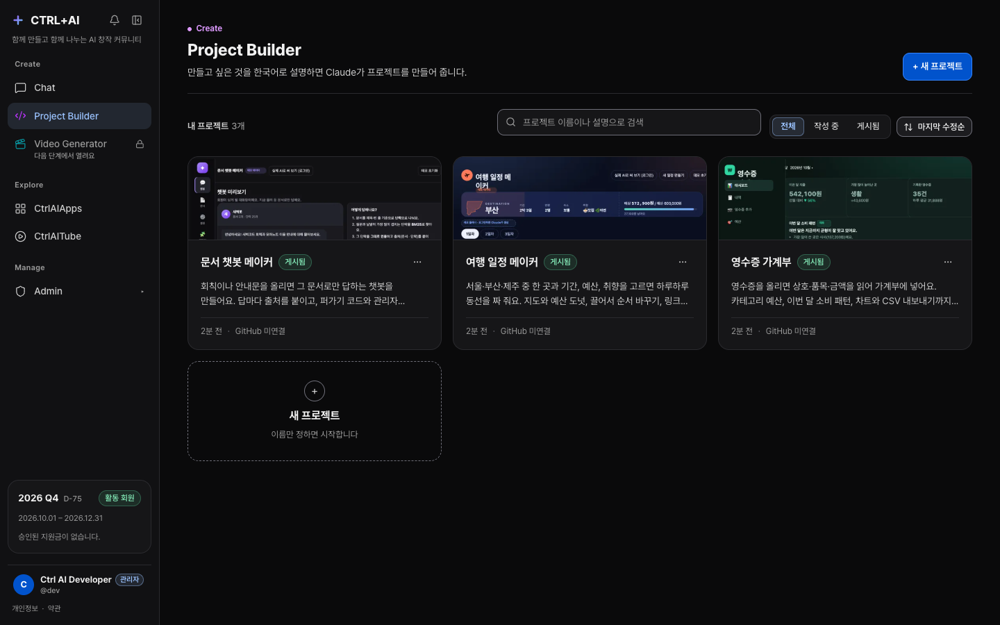
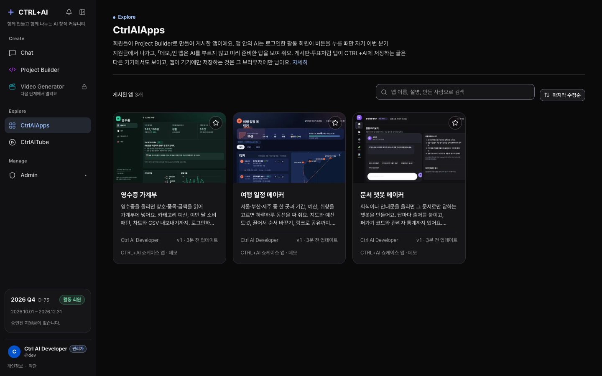
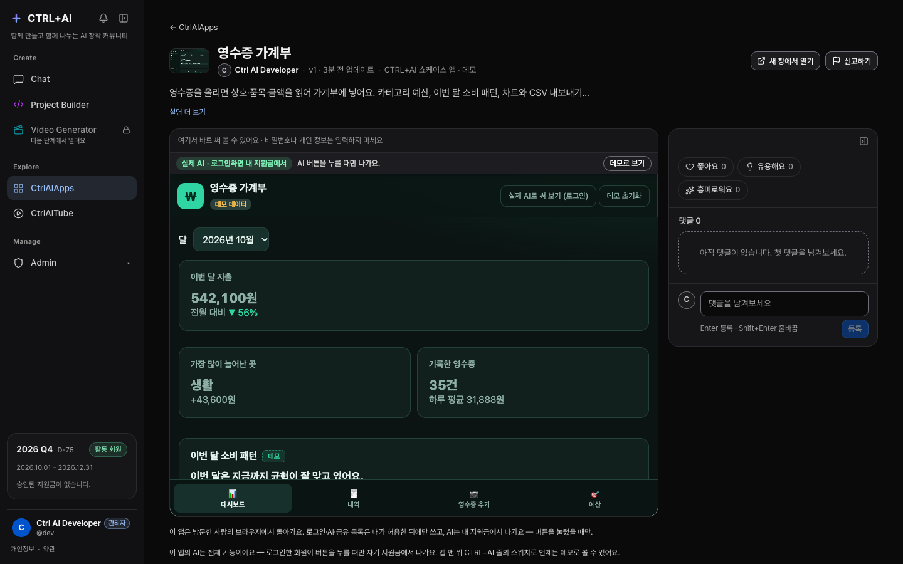
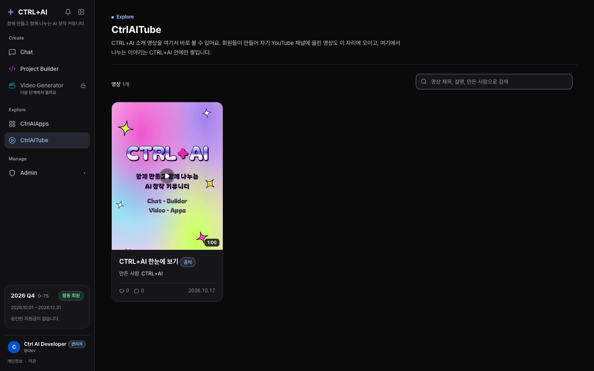
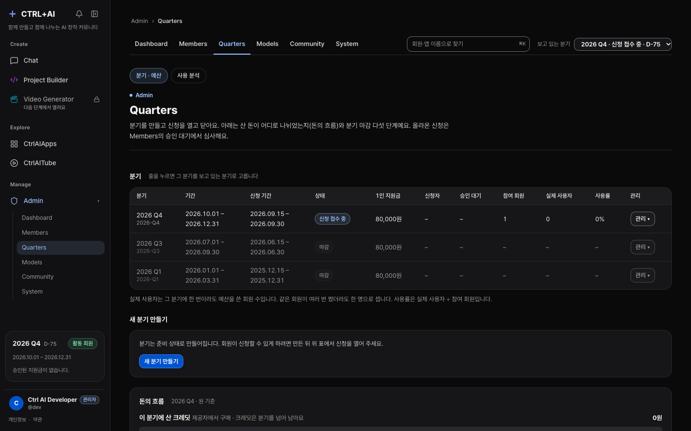

<p align="center">
  
</p>

<p align="center">
  <b>코딩 없이, 말로 앱과 영상을 만들고 나누는 AI 창작 동아리</b><br>
  A Korean-first AI creation community — describe it, CTRL+AI builds it, share it.
</p>

<p align="center">
  
  
  
  
  
  
</p>

<p align="center">
  
</p>

`내가 원하는 것을 말한다 → CTRL+AI가 만들어 준다 → 공유한다`

CTRL+AI is the club's own platform. Members — most of them new to code —
describe an app or a short video in Korean; Claude builds it in the
**Project Builder**, it runs safely on `apps.ctrlai.my`, and the club sees it
in **CtrlAIApps** and **CtrlAITube**. The club owns provider access: members
never hold API keys, and every won spent comes out of one 동아리 지원 wallet
per member per quarter, recorded per member, quarter and provider.

> **Beta, invite-only.** The site runs at [ctrlai.my](https://ctrlai.my) for
> invited members. Every external provider also has a **mock**, so the whole
> platform runs locally with no API keys.

## Screens

| | |
| :-: | :-: |
| <br>**Chat** — Claude chat and the way into every feature | <br>**Project Builder** — your projects, with real screenshots |
| <br>**CtrlAIApps** — the club's published apps | <br>**An app** — runs in a sandbox, with reactions and comments |
| <br>**CtrlAITube** — the club's videos | <br>**Admin** — quarters, wallets, the money flow, usage |

## What it does

- **Chat** — Claude (Sonnet / Haiku) with files, charts, tables and live
  HTML previews; a reply keeps going if you leave the page; pin and fold
  conversations; a preview can start a Builder project with its design and
  requirements.
- **Project Builder** — say what you want; Claude plans, writes the files and
  checks them while you watch; saved versions with undo/redo; reference
  pictures; 32 Korean fonts; one click to publish.
- **Member apps (기능 상자)** — published apps run on `apps.ctrlai.my` in a
  trusted shell around a sandboxed frame, with an SDK for storage, sign-in,
  a per-app database and AI that the visitor pays for from their own
  wallet (데모 or 전체 기능, the maker's choice).
- **CtrlAIApps & CtrlAITube** — the club's gallery: real thumbnails taken by a
  headless browser in an isolated container, reactions, comments, 신고.
- **Money** — one wallet per member per quarter, in won; every charge is one
  locked transaction with its usage event; estimates before every paid
  action; the spend shown as it happens.
- **Admin** — six sections (Dashboard · Members · Quarters · Models ·
  Community · System): 처리할 일 and alerts, a member panel with every action,
  the quarter's money flow and close-out steps, usage analysis with a Concur
  CSV, the site banner, audit log.

## How it fits together

```text
browser ──► ctrlai.my (Caddy, HTTPS)
              ├─ web   Next.js — every screen, proxies /api/*
              └─ api   FastAPI — auth, wallets & usage ledger, Claude, Builder
                         └─ db  PostgreSQL 16 (Alembic owns the schema)
browser ──► apps.ctrlai.my — the trusted shell + sandboxed member app (no cookies of the site)
api ──unix socket──► thumbs — headless Chromium on an internal network (thumbnails only)
```

Providers sit behind interfaces with a mock chosen by an environment
variable (`CLAUDE_PROVIDER`, `VIDEO_PROVIDER`, `GITHUB_PROVIDER`,
`YOUTUBE_PROVIDER`, `GOOGLE_LOGIN_PROVIDER`, `FX_PROVIDER`,
`THUMBNAIL_RENDERER`); the mock is the default (thumbnails default to `browser`). Details:
[`docs/architecture.md`](docs/architecture.md).

## Run it locally

**Prerequisites:** Python 3.11+, Node.js 20+, PostgreSQL 16 (Docker Desktop's
`docker compose up -d`, or Homebrew on a Mac). No API keys needed.

<details open>
<summary><b>macOS / Linux</b></summary>

```bash
cp .env.example .env
docker compose up -d                      # or a local PostgreSQL 16
cd backend
python3 -m venv .venv
.venv/bin/pip install -r requirements.txt -r requirements-dev.txt
.venv/bin/alembic upgrade head
.venv/bin/python -m app.db.init_db        # development seed
.venv/bin/uvicorn app.main:app --reload --port 8000
```

```bash
cd frontend
npm install
npm run dev                               # http://localhost:3000
```
</details>

<details>
<summary><b>Windows (PowerShell)</b></summary>

```powershell
Copy-Item .env.example .env
docker compose up -d
cd backend
py -m venv .venv
.\.venv\Scripts\python.exe -m pip install -r requirements.txt -r requirements-dev.txt
.\.venv\Scripts\python.exe -m alembic upgrade head
.\.venv\Scripts\python.exe -m app.db.init_db
.\.venv\Scripts\python.exe -m uvicorn app.main:app --reload --port 8000
# in another terminal
cd frontend; npm.cmd install; npm.cmd run dev
```

`npm.cmd` rather than `npm`: PowerShell's default execution policy blocks
`npm.ps1`.
</details>

Open **http://localhost:3000** and sign in as `dev` / `devpassword`
(development only — the seed refuses to run anywhere else), or with the
mock Google page. Member apps locally: `python -m app.dev_apps_server` on
`:8300` with `APPS_BASE_URL=http://localhost:8300`. Reset the local data
with `python -m app.db.reset_dev`. Everything else — environment files,
sign-in, troubleshooting — is in [`docs/development.md`](docs/development.md).

**Tests** — none of them call a paid API:

```bash
cd backend && .venv/bin/pytest
cd frontend && npm test && npx tsc --noEmit && npm run lint && npm run build
cd frontend && npm run e2e        # Playwright against a running stack (see playwright.config.ts)
```

A few backend tests need real PostgreSQL; they use their own database
(`TEST_DATABASE_URL`, default `ctrlai_test`) and skip when none is running.
See [`docs/development.md` › Verifying the project](docs/development.md#verifying-the-project).

## Deployment

The beta runs on one Google Cloud VM (Seoul) with `docker-compose.prod.yml`:
Caddy, web, api, PostgreSQL and the `thumbs` worker. GitHub Actions builds
the images on every push to `main`; the server only pulls them, and
`deploy/update.sh` backs up, migrates and restarts. Step by step, in Korean:
[`docs/deployment.md`](docs/deployment.md). Secrets live only in the
server's `.env` (`chmod 600`, never committed).

## Contributing

Work follows [`CLAUDE.md`](CLAUDE.md) (decisions, standing rules, git
workflow) and [`docs/BACKLOG.md`](docs/BACKLOG.md) (the only place the order
of work is written; milestones in [`docs/ROADMAP.md`](docs/ROADMAP.md)).
One branch per item, small commits, all tests and the build before a merge.

## Where to find things

| Document | What it holds |
| -------- | ------------- |
| [`CLAUDE.md`](CLAUDE.md) | The settled decisions, the standing rules every change follows, and the working method |
| [`docs/ROADMAP.md`](docs/ROADMAP.md) | Milestones M0–M4 and what is done in each |
| [`docs/archive/phases.md`](docs/archive/phases.md) | The long phase plan (Phases 0–9) and the Phase 0–1c delivery history |
| [`docs/BACKLOG.md`](docs/BACKLOG.md) | **The order of work**: Now, Next, open specs, UI requests |
| [`docs/product.md`](docs/product.md) | Screens and routes, the two workspaces, language and design, money, participation, search, leaving CTRL+AI |
| [`docs/development.md`](docs/development.md) | Full setup, sign-in, how the pieces fit, environment files, providers, testing, troubleshooting, operator notes, repository layout |
| [`docs/deployment.md`](docs/deployment.md) | 배포 안내서 (Korean): setting up `ctrlai-server`, HTTPS, real Claude, backups, updates, cron, billing dates |
| [`docs/api-distribution.md`](docs/api-distribution.md) | API 분배 (Korean): one club key, per-member wallets as limits, the guards against draining it, Console-side rules |
| [`docs/dns-for-domain-owner.md`](docs/dns-for-domain-owner.md) | The DNS records for `ctrlai.my` and how to check them (Korean) |
| [`docs/architecture.md`](docs/architecture.md) | Target infrastructure, storage and security principles |
| [`docs/research/chat-plus-research.md`](docs/research/chat-plus-research.md) | Prices and terms behind the Chat+ specs: Claude vision, PDF, Files API, server tools; image generation; Gemini, Grok, OpenRouter |
| [`docs/research/deepseek-research.md`](docs/research/deepseek-research.md) | DeepSeek for the chat catalogue: its own API (prices, data in China, terms), US hosts and OpenRouter routing, price comparison, recommendation |
| [`docs/archive/done.md`](docs/archive/done.md) | Every merged item, newest first |
| [`docs/archive/done-specs.md`](docs/archive/done-specs.md) | Full specs of merged items |
| [`docs/archive/phase-table.md`](docs/archive/phase-table.md) | The old phase table, superseded by the roadmap |
| [`docs/ui-requests/`](docs/ui-requests/) | Mock-ups and screenshots behind UI requests |
| [`frontend/README.md`](frontend/README.md) | Frontend-only commands |

## License

[Apache License 2.0](LICENSE).
